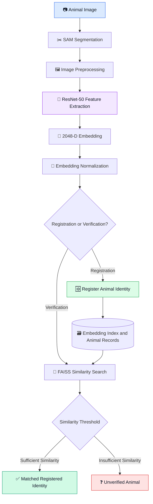

<div align="center">

# 🐄 Animal Identification & Livestock Intelligence

### 🧬 AI-Powered Livestock Trust & Welfare Platform

<p>
  <b>From animal identity to intelligent livestock management.</b>
</p>

<p>
  
  
  
  
</p>

<p>
  
  
  
</p>

</div>

---

## 🌟 Overview

The **Animal Identification & Livestock Intelligence Platform** is an AI-driven project designed to identify individual livestock animals from images and build a foundation for intelligent livestock management.

The core identification pipeline uses computer vision and deep learning to extract distinctive visual features from animal images. These features are converted into numerical embeddings and compared against registered animals using similarity search.

The broader platform aims to integrate animal identity verification with species and breed classification, livestock records, vaccination reminders, health monitoring, and data-driven livestock insights.

🎯 **Vision:** Build a reliable digital identity and intelligent management system for livestock, supporting farmers and future livestock welfare applications.

---

## ✨ Key Features

### 🧬 Animal Identity & Verification
- 🖼️ Image-based animal registration.
- ✂️ Animal segmentation using the Segment Anything Model (SAM).
- 🧠 Deep feature extraction using ResNet-50.
- 🔢 Generation of 2048-dimensional feature embeddings.
- 🔎 Similarity search using FAISS.
- ✅ Similarity-threshold-based identity verification.
- 🆔 Matching against previously registered animal identities.

### 🐃 Species & Breed Intelligence
- 🐄 Support for cattle and buffalo identification workflows.
- 🧬 Planned species and breed classification.
- 📊 Breed-specific model development and evaluation.
- 🗂️ Structured animal profiles for future livestock records.

### 🌱 Livestock Intelligence — Planned Extensions
- 💉 Vaccination schedules and reminders.
- 🩺 Health monitoring and anomaly alerts.
- 🥛 Milk-yield prediction using historical records.
- 📋 Centralized livestock profiles and management dashboards.
- 🤖 An intelligent assistant for livestock-related insights.

> **Project status:** Identity registration and verification form the core development pipeline. Breed classification and livestock-management capabilities are part of the broader development roadmap and should be marked complete only after implementation and testing.

---

## 🏗️ System Architecture



---

## 🔄 How Animal Identification Works

### 1. 📷 Image Input
An image of the animal is supplied for registration or identity verification.

### 2. ✂️ Animal Segmentation
SAM is used to isolate the relevant animal region from the image.

### 3. 🧠 Feature Extraction
A pretrained ResNet-50 model extracts a 2048-dimensional feature representation from the processed image.

### 4. 🔢 Embedding Generation
The feature vector is normalized to support consistent similarity comparisons.

### 5. 📝 Registration
During registration, the animal's embedding is stored and associated with its assigned identity.

### 6. 🔎 Verification
During verification, the query embedding is compared with stored embeddings using FAISS.

### 7. ✅ Identity Decision
The similarity score is compared with a configured threshold. A sufficiently similar candidate can be returned as a match; otherwise, the animal remains unverified.

> Similarity is not proof of identity. The threshold must be calibrated and evaluated on representative images, including images of different animals, lighting conditions, angles, and distances.

---

## 🛠️ Technology Stack

| Technology | Purpose |
|---|---|
| 🐍 Python | Core programming language |
| 🔥 PyTorch | Deep learning and model inference |
| 🧠 ResNet-50 | Visual feature extraction |
| ✂️ SAM | Image segmentation |
| 👁️ OpenCV | Image processing |
| 🔎 FAISS | Embedding similarity search |
| 🔢 NumPy | Numerical operations |
| 📓 Jupyter / Google Colab | Development and experimentation |
| 🐙 Git / GitHub | Version control |

---


## 🧬 Breed Classification Module

Animal identity and breed classification solve two different problems.

- **Species Classification:** Identifies the animal category, such as cow or buffalo.
- **Breed Classification:** Predicts the breed within an animal category.
- **Individual Identification:** Determines whether an animal matches a previously registered identity.

The project uses both **cow and buffalo datasets** to support livestock identification and classification research.

### 🐄 Cow Dataset
The cow dataset is used for cattle-related image processing and identification tasks. Cow breed classification can be incorporated according to the breed labels available in the dataset.

### 🐃 Buffalo Dataset
The buffalo dataset is used for buffalo identification and breed classification experiments. The cleaned dataset includes the following breeds:

- Banni
- Bargur
- Bhadwari
- Chhattisgarhi
- Chilika
- Gojri
- Jaffarabadi
- Murrah
- Nagpuri
- Nili-Ravi
- Pandharpuri

### 🎯 Project Goal

Integrate species recognition, breed classification, and individual animal identification into a unified livestock intelligence platform. These capabilities require appropriate labels and evaluation for each task.


---

## 📂 Project Structure

```text
animal-identification/
│
├── data/
│   ├── raw/
│   ├── cropped_faces/
│   └── embeddings/
│
├── models/
│   └── pretrained_and_trained_models
│
├── utils/
│   ├── embedding_utils.py
│   ├── similarity_utils.py
│   └── preprocessing_utils.py
│
├── register_animals.py
├── verify_animals.py
├── requirements.txt
└── README.md
```

> This is a conceptual structure for organizing the project. Keep the filenames and folders aligned with the actual files in your repository.

---

## 🚀 Getting Started

### Prerequisites

- Python
- Git
- A compatible PyTorch environment
- Animal images for registration and verification

### 1. Clone the Repository

```bash
git clone https://github.com/archita213V/Animal-Identification-Using-Embedding.git
cd Animal-Identification-Using-Embedding
```

### 2. Create a Virtual Environment

```bash
python -m venv animal_env
```

Activate it on Windows:

```bash
animal_env\Scripts\activate
```

### 3. Install Dependencies

```bash
pip install -r requirements.txt
```

Ensure that the requirements file contains the dependencies used by your current implementation, including PyTorch, OpenCV, NumPy, and FAISS.

### 4. Prepare Animal Images

Organize the images according to the directory structure expected by your registration pipeline.

Use multiple images of each animal where possible, with variations in angle, lighting, and background.

### 5. Register an Animal

```bash
python register_animals.py
```

The registration script should extract the animal's embedding and associate it with a persistent identity record.

### 6. Verify an Animal

```bash
python verify_animals.py
```

The verification script should compare the input image against registered embeddings and return the best candidate according to the configured similarity threshold.

> **Important:** These commands assume that the scripts support command-line execution and their required image paths and storage locations are configured. Adapt them to the actual implementation.

---

## 🔬 Evaluation Strategy

The system should be evaluated separately for each task.

### Individual Animal Identification
- Top-1 identification accuracy
- Precision and recall for identity verification
- False acceptance rate
- False rejection rate
- Similarity-threshold calibration

### Breed Classification
- Accuracy
- Precision, recall, and F1-score
- Confusion matrix
- Per-breed performance

### System Performance
- Embedding extraction time
- Similarity search latency
- Memory usage
- Performance as the registered animal collection grows

---

## 🔮 Future Roadmap

- [ ] Integrate individual identity verification with breed classification.
- [ ] Extend support to additional livestock species.
- [ ] Build persistent animal profiles and metadata storage.
- [ ] Develop a farmer-friendly web or mobile application.
- [ ] Add vaccination tracking and reminders.
- [ ] Explore health monitoring and anomaly detection.
- [ ] Develop milk-yield prediction from historical records.
- [ ] Integrate an intelligent livestock assistant.
- [ ] Evaluate identification reliability on larger, diverse datasets.
- [ ] Deploy the complete platform for practical testing.

---

## 🌍 Potential Applications

- 🧑‍🌾 Livestock record management
- 🆔 Digital animal identity verification
- 🛡️ Support for livestock insurance workflows
- 🏛️ Support for livestock registration and welfare programs
- 💉 Vaccination and health record management
- 🥛 Data-driven dairy farm management

These are intended applications; integration with official registration, insurance, or government systems would require additional validation and appropriate authorization.

---

## 👩‍💻 Author

<div align="center">

### Archita Verma

🎓 B.Tech Computer Science and Engineering  
🤖 Machine Learning & Computer Vision Enthusiast

<a href="https://github.com/archita213V">
  
</a>

<a href="https://www.linkedin.com/in/archita-verma-b140282bb">
  
</a>

</div>

---

<div align="center">

**🐄 Building smarter livestock identification with AI 💚**

⭐ If you find this project interesting, consider starring the repository!

</div>
